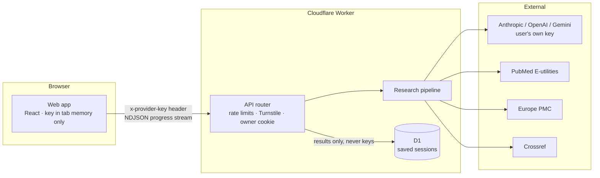

# Architecture

Synthora turns a clinical research question into a cited, verified report. It runs as **one Cloudflare Worker** that serves the web app and the API, uses **the user's own LLM key** for every model call, and **checks every model output with deterministic code** before using it.



## The pipeline

Each step either runs plain code or calls the model and then verifies the model's output in code. The model's job is judgment; code's job is everything that can be checked.

| # | Step | Model? | What code guarantees |
|---|---|---|---|
| 1 | **Plan** (`agents/planner`) | Yes: concepts and synonyms | Code builds every query from the plan; terms are stripped of operators, so they cannot inject query syntax. Falls back to the question as written if planning fails or finds nothing |
| 2 | **Search** (`literature/`) | No | PubMed + Europe PMC in parallel; conservative identifier-based deduplication; BM25 relevance fused with each source's ranking (reciprocal rank fusion) |
| 3 | **Extract** (`agents/extraction`) | Yes, per paper | Every item must quote the abstract verbatim; quotes, sample sizes and metric values are checked against the source text. Papers without abstracts are skipped at no cost |
| 4 | **Analyse** (`agents/analysis`) | Yes | Evidence catalog, study table and metric groups are built by code. Model claims must cite real evidence ids; agreements and conflicts must span two papers |
| 5 | **Verify** (`agents/verification`) | Yes: claim support | Crossref DOI/title check and retraction flags (code); a reviewer prompt rates each claim against its quotes; unsupported claims are dropped |
| 6 | **Write** (`agents/synthesis`) | Yes: narrative only | Methods, review limitations and references are composed by code. Every model sentence must cite evidence, and every number in it must appear in that evidence |

Anything rejected at any step is recorded with a reason and shown in the UI's Verifier card. These records are also the raw data for the reliability metrics in [evaluation.md](evaluation.md).

All model steps go through one helper (`agents/structured.ts`): prompt → parse JSON → validate with Zod → one repair attempt with the validation errors → structured failure that keeps the tokens spent. Data from papers is wrapped as data in prompts, and tag-like sequences are neutralised so a paper cannot inject instructions.

## Bring your own key

- The key is entered in the browser and held **only in React state**. It is never written to storage, cookies or the URL.
- It travels only in the `x-provider-key` header. On the server it is wrapped in `ApiKey`, which prints as `[REDACTED]` through every implicit conversion; only the provider adapter calls `reveal()`.
- Provider error text is discarded and replaced with Synthora's own messages, because some providers echo part of the key.
- Adapters are created per request and never cached. OpenAI calls set `store: false`.
- Nothing about keys is persisted, logged or returned. Tests assert keys never appear in URLs, responses, saved sessions or evaluation results.

## Live progress and cancellation

`POST /api/research/preview` with `accept: application/x-ndjson` streams one JSON event per line as each step actually starts and finishes, ending with the result. Closing the stream (the UI's Cancel) makes further writes fail; the pipeline checks for that before every model call and stops, so a cancelled run stops spending the user's tokens.

## Storage and ownership

Completed runs are saved to D1 (`database/migrations/`) as schema-validated JSON. There are no accounts. Each browser gets a random 256-bit token in an HttpOnly, SameSite=Lax cookie, and the server stores only its SHA-256. Every query is scoped to that owner, and another browser's session id reads as "not found". Runs that produced no verified data are not saved.

## Abuse protection

| Layer | Setting |
|---|---|
| Rate limits (per client IP, Cloudflare `ratelimits` bindings) | Key verification 10/min · research runs 5/min |
| Turnstile (optional) | When configured, verification and runs need a fresh token bound to the action, verified server-side; fails closed |
| Security headers (`apps/web/public/_headers`) | Strict CSP, `frame-ancestors 'none'`, nosniff, HSTS, restrictive Permissions-Policy |
| Request validation | Zod schemas on every body; 16 KB body limit; per-route methods with 405s |

## Repository layout

```
apps/web/            React + Vite + Tailwind UI (served by the Worker as static assets)
apps/worker/src/
  agents/            planner, extraction, analysis, verification, synthesis + shared structured-output loop
  literature/        PubMed, Europe PMC, Crossref clients; dedupe; ranking
  providers/         Anthropic / OpenAI / Gemini adapters and ApiKey
  research/          the pipeline
  security/          rate limiting and Turnstile
  storage/           D1 session store and anonymous ownership
apps/worker/eval/    evaluation CLI and metrics
apps/worker/cli/     research CLI (the same pipeline under Node)
sandbox/openshell/   OpenShell image and policy for the research CLI
packages/schemas/    Zod schemas shared by Worker and UI
database/migrations/ D1 schema
research/            evaluation datasets and experiment results
docs/                architecture, evaluation, deployment, decisions
```

## Key decisions

- [0001: Orchestration in TypeScript on Workers](decisions/0001-typescript-on-workers.md)
- [0002: No durable workflows while keys are user-supplied](decisions/0002-no-durable-workflows-with-byok.md)
- [0003: NVIDIA OpenShell runs a sandboxed copy of the pipeline](decisions/0003-openshell-sandboxed-runner.md)
